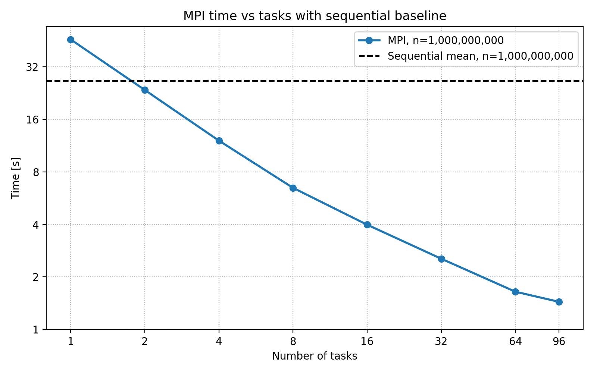
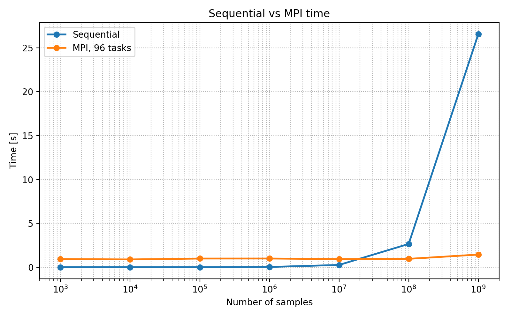
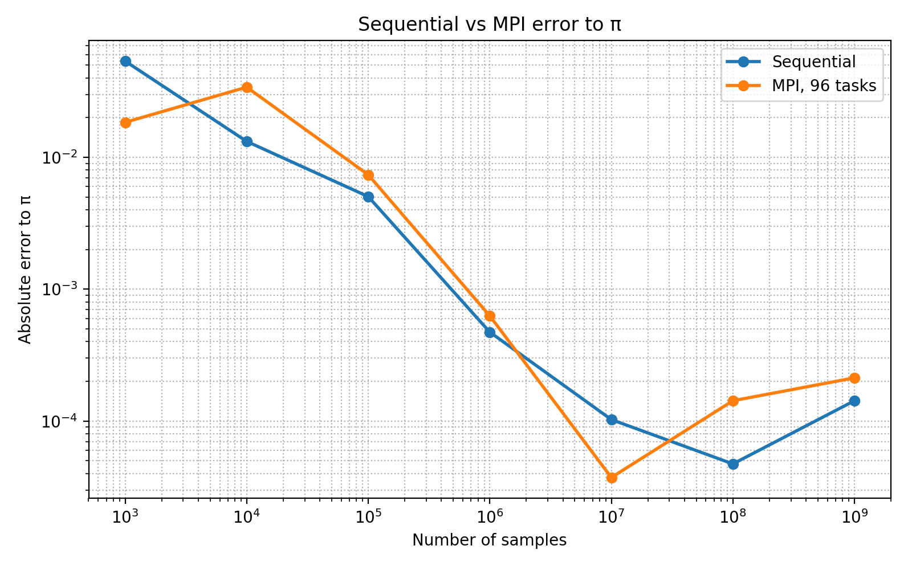
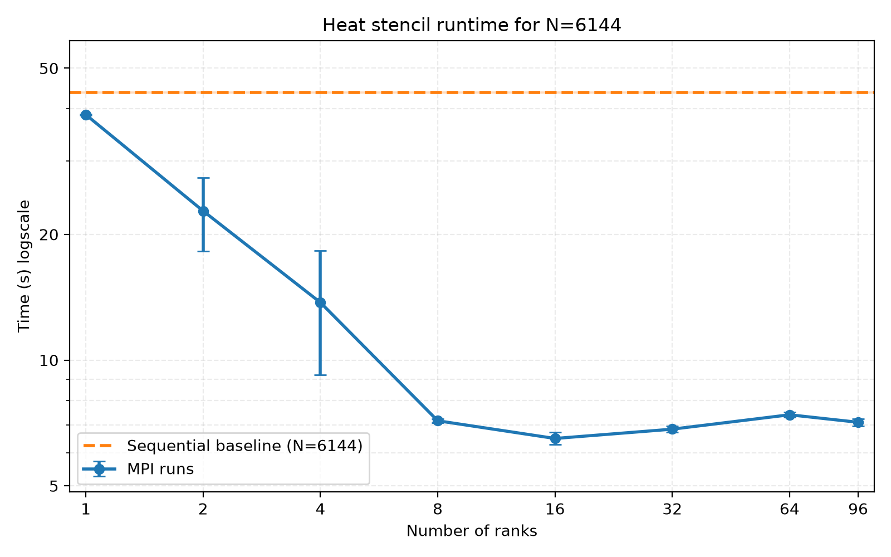
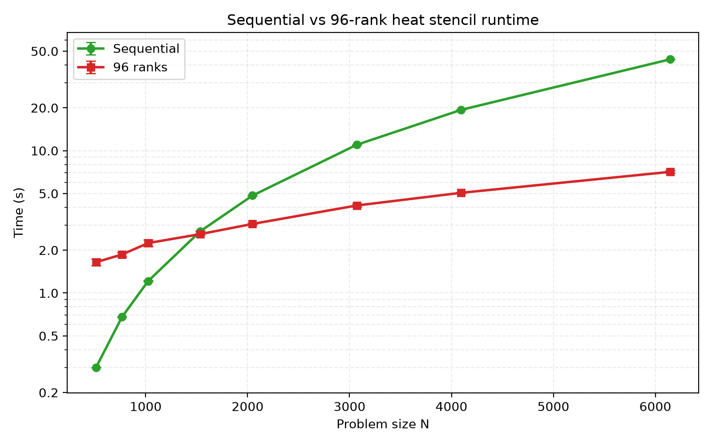

# Exercise 1

## Implementation

The implementation is really simple. First the rank 0 calculates the number of samples every rank has to simulate and the rest, in case the number of samples is not divisible by the number of samples. Then it broadcasts that number to every rank. The 0 rank then adds the rest to its number of samples. Every rank does the sampling and at the end there is a sum reduction for the the number of samples in the circles. 

I realised a bit too late, that the first broadcast is completely useless, everybody can just calculate the samples own its own and only rank 0 adds the remainder. If i have time to implement I'll do that

## Results

### comparing ranks for n=10⁹
So when looking at the time for samples=10⁹ we can see that for ranks=1 the sequential implementation is actually faster by almost a factor 2, because the mpi overhead. For 2 ranks the time is about the same and after that there is a nice linear decline in execution time. This is because the problem is embarassingly parallel. For n=96 we get a speedup of 19.3x.

| ranks | sequential time [s] | mpi time [s] | speedup vs seq |
| --- | ---: | ---: | ---: |
| seq | 27.406000 | - | 1.000 |
| 1 | 27.406000 | 46.439000 | 0.590 |
| 2 | 27.406000 | 26.162000 | 1.048 |
| 4 | 27.406000 | 12.356000 | 2.218 |
| 8 | 27.406000 | 6.539000 | 4.191 |
| 16 | 27.406000 | 3.869000 | 7.083 |
| 32 | 27.406000 | 2.371000 | 11.559 |
| 64 | 27.406000 | 1.658000 | 16.530 |
| 96 | 27.406000 | 1.420000 | 19.300 |

### comparing sequential to max ranks
We can see that for smaller n the sequential implementation is faster. After 10⁷ samples the execution time rises dramatically, while the parallel version stays really stable and scales well.

### Error to pi
I mean this version to approximate pi is really bad. It is computationally expensive and does not a good job at approximating it. but there is not really a significant difference in implementation, when it comes to error. Interestingly it seems that with more samples the accuracy goes down after 10⁷ for mpi and after 10⁸ for sequential. I dont know if this is actually there is numeric reason behind it. Maybe fp precision error or problems with the rng

---
AI notice:
The python scripts as well as the parsing for the csv file in the slurm scripts was done with the help of GPT

# Exercise 2

## Parallelisation

The main idea is:
- the root rank initialises the main vector 
- splits the array in equal chunks for each array
- sends the chunks to each rank with scatter(v since the chunks might not be equal in size) 
- each timestep each rank requests the left and right neighbor cell and sends its left and right boundary cell (both non blocking)
- then does the computation for the inner cells
- after the inner cells it waits for the send and receive for the boundary to be finished and does the boundary computation
- every 10000 timesteps it prints the heat distribution so the root rank needs to gather all the parts and print it, this is also done at the very end
  
### Some Details

- I used MPI_scatterv/gatherv, This is for the not so unlikely case that N is not divisible by number of ranks. for the loadbalancing I added 1 to every rank that is before the remainder
- the first and last rank can't send their left and right boundary so I used to have an if else block for that, the problem was, that if the last rank was also the first rank I ran into some problems. The Goods (Claude Opus 5.5 that is) suggested that i use MPI_PROC_NULL instead, if the rank is the first and/or the last rank. This basically sends nothing and is done immedeately and helped to reduce the if else only after the inner computation
- Because MPI_Isend semantics, the boundry values shouldn't be used so the second to last cell also can only be computed after the Wait
- The heat source could also be on one of the 4 boundary cells, so this also has to be checked and set. One could actually save one send and receive that way, but this was a bit too annoying for probably little payoff

## Results
### N=6144 across different ranks
It can be seen, that even for 1 ranks my MPI implementation is faster than the sequential version, which is really interesting. Then th time decreases dramatically until 8 ranks, where it begins to kind of plateou. For 16 ranks it is the fastest and it seems to kind of go up and down further on. I assume the biggest bottleneck is the MPI_Gatherv every 10000 timesteps for printing. If there were a way to do this better asynchronously I assume there would be an even better speedup.

| Ranks | Mean time (s) | Std (s) | Runs | Speedup |
|------:|--------------:|--------:|-----:|--------:|
| sequential | 43.788 | 0.244 | 5 | 1.00 |
| 1 | 38.684 | 0.074 | 5 | 1.13 |
| 2 | 22.754 | 4.554 | 5 | 1.92 |
| 4 | 13.738 | 4.521 | 5 | 3.19 |
| 8 | 7.158 | 0.070 | 5 | 6.12 |
| 16 | 6.492 | 0.218 | 5 | 6.74 |
| 32 | 6.834 | 0.114 | 5 | 6.41 |
| 64 | 7.398 | 0.100 | 5 | 5.92 |
| 96 | 7.098 | 0.143 | 5 | 6.17 |

### Scaling across 96 ranks and increasing N
It shows that the mpi implementation with 96 ranks clearly scales much better than the mpi implementation. The sequential version is faster till about N=1024 which is to be expected. Here every rank only has 10-11 cells and the communication overhead clearly outweighs the speedup from parallelization. For 2N=1536 they are pretty similar in execution time. After that the sequential implementation takes much longer.

