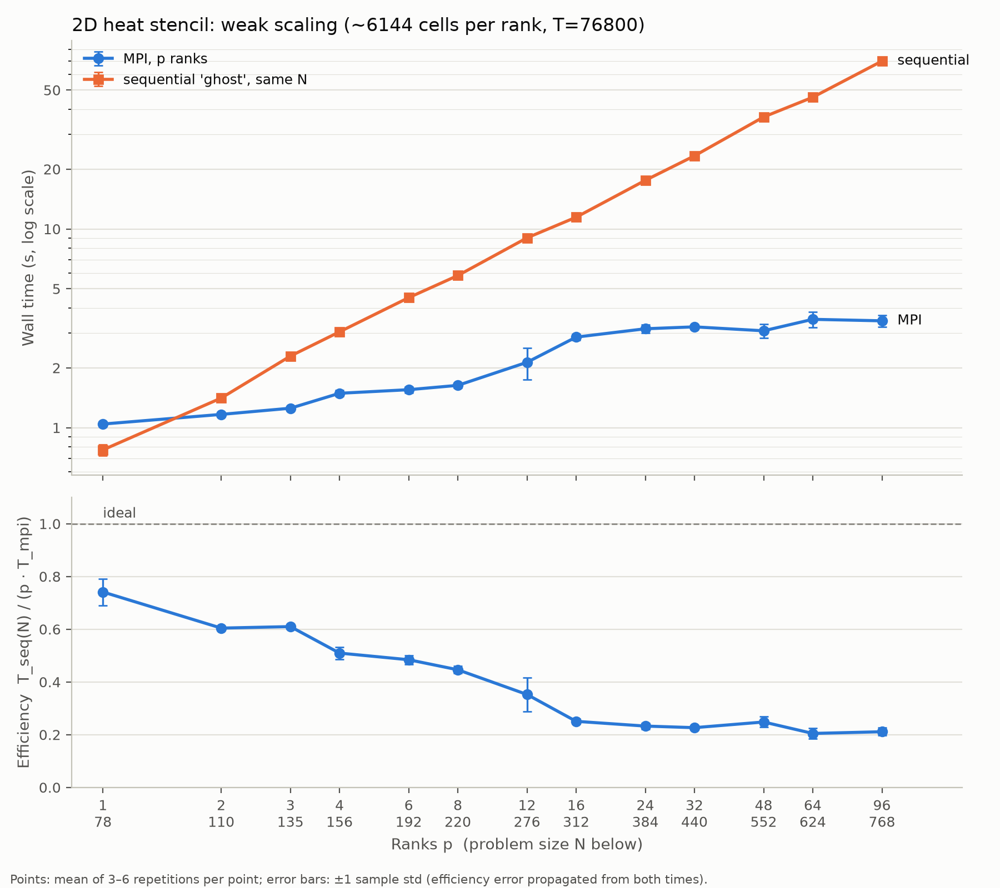
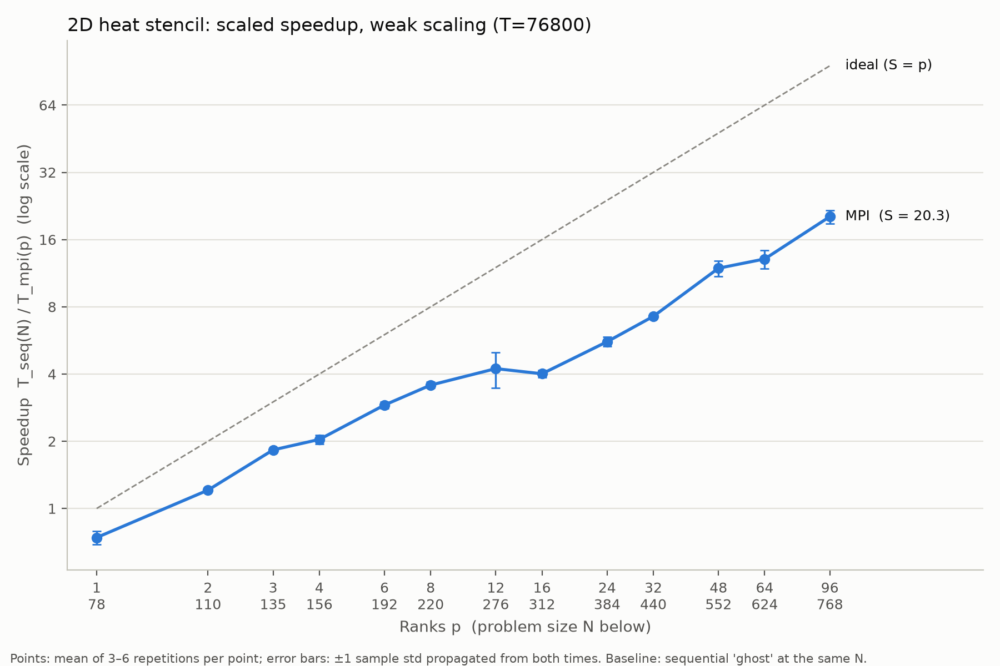
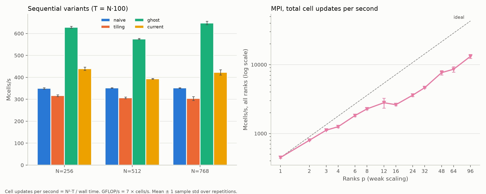
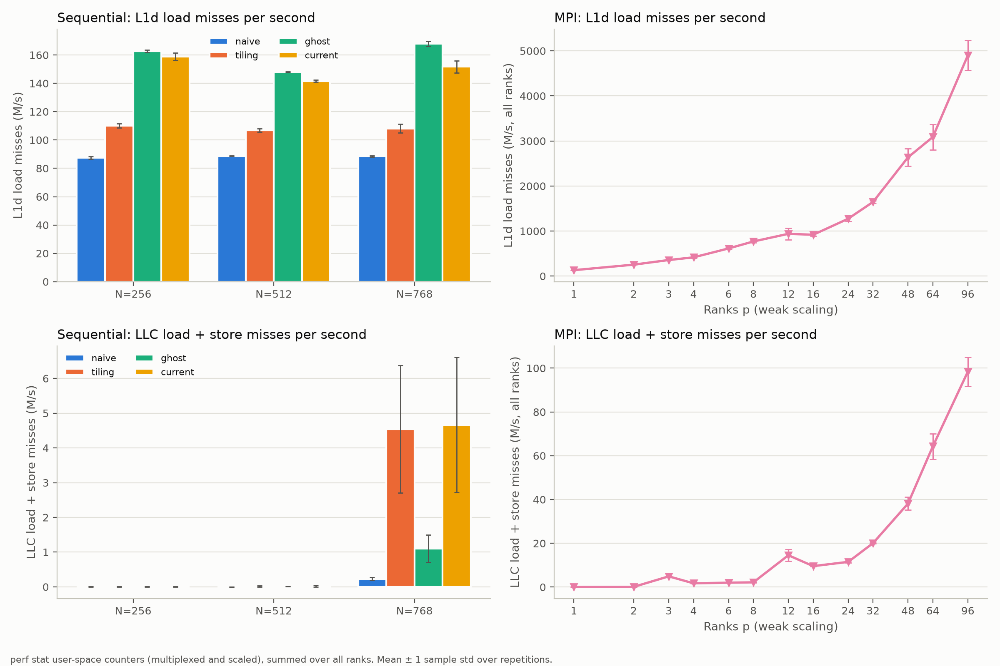
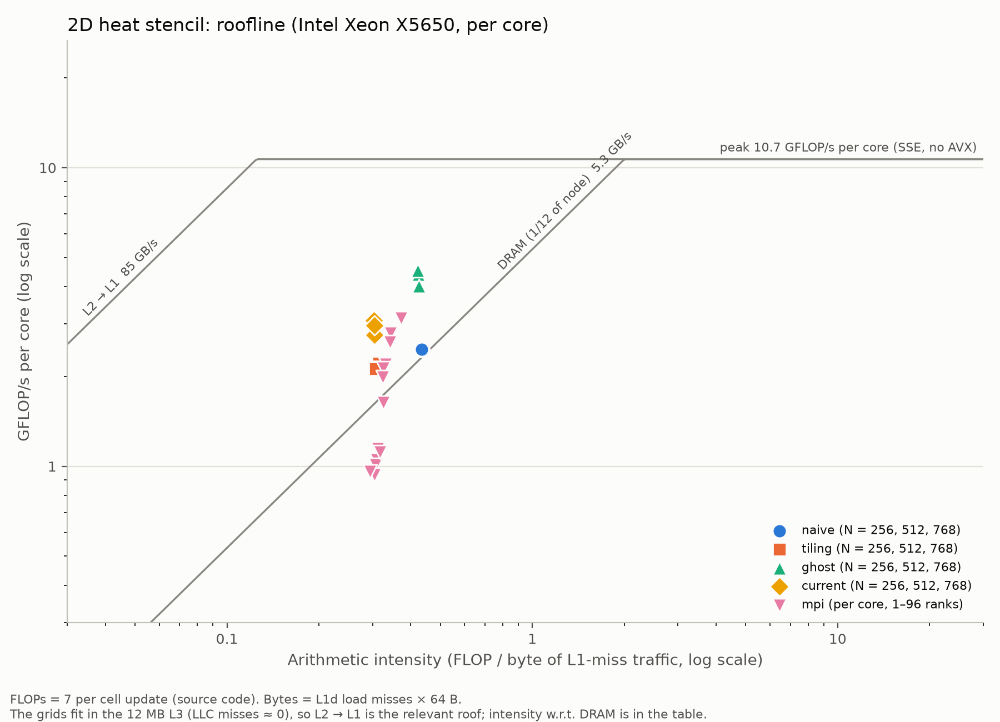
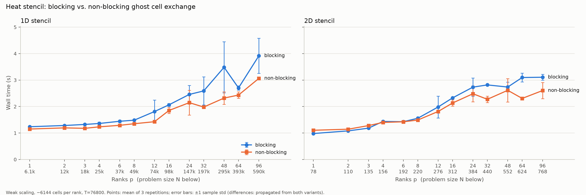
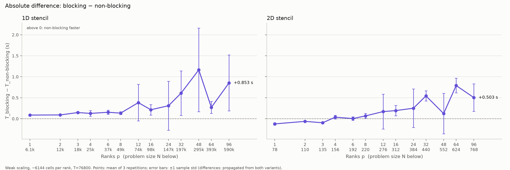
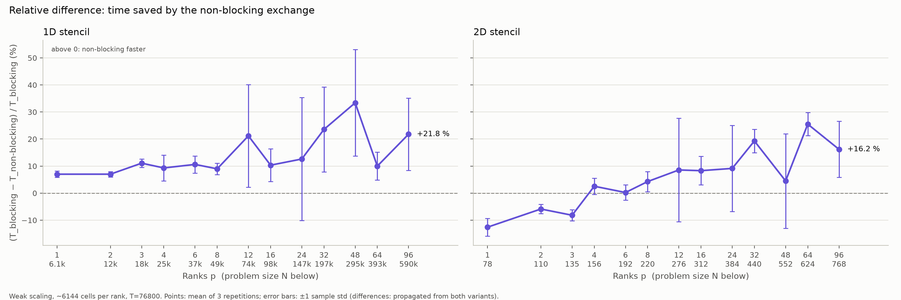

# Exercise 1

I switched the program to c++, beause I want to get better at c++.

For the 2 dimensional case I did a single vector with NxN entries and used N*y+x to get the index. Then just add double for loops everyehere and that's and changed the formula to subtract 4 times the tc from the sum of neighbor cells. (Since there are 4 now)

For optimization I first tried tiling, but it didn't really make the program faster, this is because the entire grid fits in L2 cache and is therefore not really memory bound.
So i decided to rewrite the loop body so it can be vectorized, by removing the conditionals inside it. The source is just computed normally and just set to the correct value afterwards and I added one ghost cell to the borders so the grid is now (1+N+1)x(1+N+1).
This made the program faster by about 50-80%.
I got this idea from this super cool MHD-solver.

The MPI version follows a similar pattern, only now I wanted to decompose the field into rectangular blocks. In my mind this is better since we have more sends but also less data to send. With rows we need to send 2 rows so 2N cells. For blocks we send 2(N/block-height + N / block-width) cells, which is less data if block-width is less data if  1/block-width + 1/block-height is larger than 1 which it is pretty quikly. So for a sufficiently large grid this should be better. We also have more cells to perform work on when doing it with latency hiding. These are all just thoughts, I did not have time to actually verify this (for now). The caveat is that for the blocks to work the N needs to be nicely divisible by the given block dimensions, which depend on the number of ranks.

I decided to use weak scaling, since the number of ranks and N is pretty related because of the constraint from the block decomposition.

It can be seen from the figures that the application sadly does not scale linearly, because the communication overhead is pretty detremental for the performance.

For domain specific metrics I used Cells (Million cells) updated per second. I additionally recorded the L1 and LLC misses per second. I also used Claude to draw a roofline diagram, based on theoretical throughput of the nodes on LCC3. It is important to use the memory bound of the L2 bandwidth, since all test fields fit in the L2 cache.

For correctness I currently have the same check as for the 1D version. If i would be specifically interested in the correctness of the mpi implementation, I could add a check, to see if the serial and parallel version agree.

# Exercise 2

For the non-blocking i wrote a custom non-blocking sendrecv. A native MPI implementation exists, but from what I have gathered not in OpenMPI/3, which is the version used.

So the difference between blocking and non-blocking is not world changing, but still noticable. It appears, that the difference for the 1D version is more significant, which is interesting, since less data is beeing sent. So the speedup is about 20%

