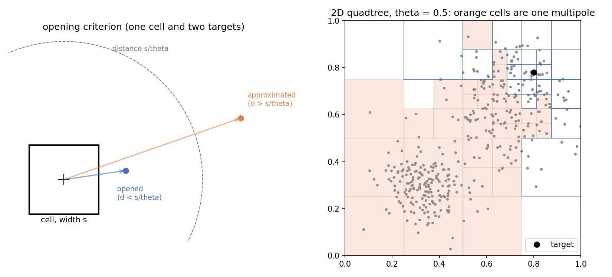
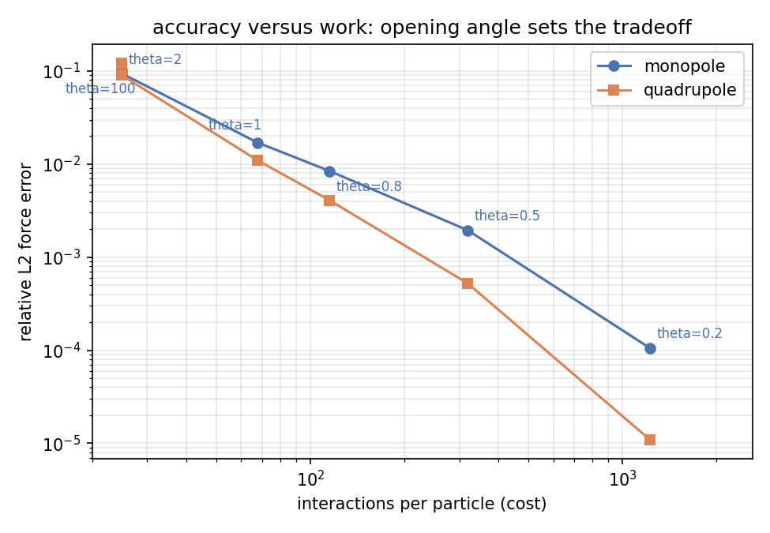
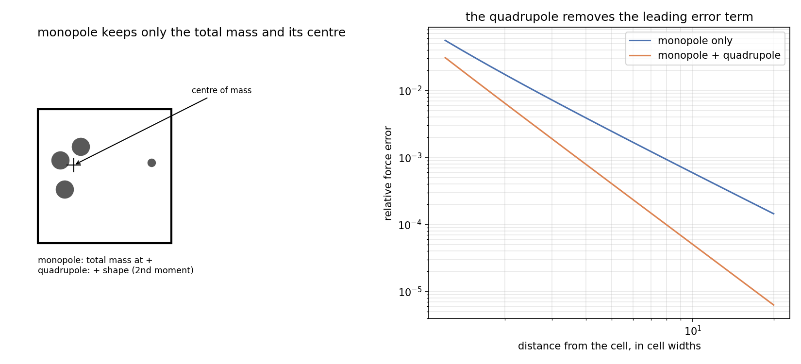
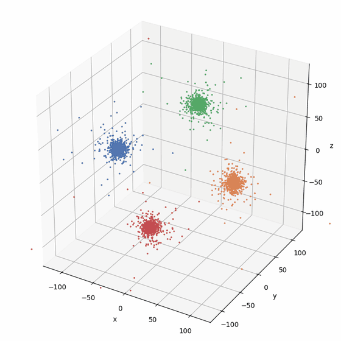

# N-body simulation

Sequential 3D N-body integrator in C++17 with two force solvers:

- `nbody` – exact O(N²) direct summation and Barnes–Hut with monopole moments
- `nbody_quad` – same, with a 3×3 quadrupole tensor per tree node (compile-time flag)

Both use drift-kick-drift leapfrog and Plummer softening (G = 1, dt = 1).
Source layout, in the order worth reading: `src/nbody.h` (vector, particle,
parameters), `src/nbody.cpp` (initial conditions, exact solver, output),
`src/octree.h`/`src/octree.cpp` (tree and Barnes–Hut), `src/main.cpp` (CLI and
time loop), `tests/validate.cpp`.

## Build

```sh
module load gcc/12.2.0-gcc-8.5.0-p4pe45v
make            # nbody, nbody_quad, validate, validate_quad
```

## Run

Everything below (simulation and rendering) must run on a compute node, not on
the login node — use `srun`/`sbatch`:

```sh
srun -p lva -n 1 --time=00:30:00 \
    ./nbody --n 5000 --steps 100 --solver direct --output results/data.dat
srun -p lva -n 1 --time=00:30:00 \
    ./nbody --solver bh --theta 0.5 --ic plummer --n 5000 --steps 100 \
            --output results/data.dat
```

Options: `--solver direct|bh`, `--ic cube|plummer|clusters`, `--theta`,
`--leaf`, `--emit` (stream frames to stdout for the live viewer),
`--energy-every N`, `--quiet` (print only the machine-readable `BENCH ...`
line).

The default opening angle is **θ = 100**, i.e. effectively no criterion (the
fastest setting). Use `--theta 0.5` or `--theta 1.0` for the accurate regime;
θ only affects the tree solver.

`make && ./validate && ./validate_quad` checks the tree against direct
summation and checks leapfrog with a two-body orbit.

## How the tree solver works

Each step builds an octree over the particles. Every cell stores its total mass
and centre of mass. For one target particle the walk starts at the root and
either

- **approximates** the cell by its multipole if the cell is small far away, or
- **opens** it and recurses into its eight children otherwise.

The cell that contains the target is always opened. A distant leaf is also one
multipole; only the leaves on the target's own path are summed particle by
particle.



The only knob is the opening angle θ: a cell is approximated when
`cell_width / distance_to_centre_of_mass < θ`. Small θ opens more cells (more
work, smaller error); large θ approximates sooner. θ = 100 disables the
criterion. The figure on the right shows all cells that become one multipole
for one target, θ = 0.5.



A monopole is just "total mass at the centre of mass"; it ignores the shape of
the cell. The quadrupole tensor
`Q_ij = Σ m (3 r_i r_j − δ_ij r²)` (measured about the centre of mass) is the
traceless second moment of the mass distribution — the covariance matrix up to
a multiple of the identity. It enters the force as

`a = −M R/|R|³ + Q R/|R|⁵ − (5/2) (R·Q·R) R/|R|⁷`

and makes the error fall like `(cell_width/distance)³` instead of `²`. At
θ = 0.5 it lowers the L2 error from 2.1e-3 to 5.7e-4.



## Method notes

- Direct solver: symmetric pair loop (Newton's third law), softening ε² added
  to r².
- Tree: cube cells, eight contiguous children, leaf capacity 16; particles are
  kept in place and grouped through an index permutation, so a leaf visit is a
  short loop over that permutation. Moments are accumulated bottom-up.
- Opening criterion: `s / d < θ`, with `s` the cell side and `d` the distance
  to the centre of mass (Barnes–Hut 1986). The test is squared to avoid a
  square root per node. A cell containing the target is always opened.
- A distant cell is accepted as a single multipole even when it is a leaf;
  only leaves on the target's own path are summed particle by particle.
- Quadrupole: `Q_ij = Σ m (3 r_i r_j − δ_ij r²)` about the cell COM, combined
  with the parallel-axis theorem. Acceleration:
  `a = −G M R/|R|³ + G [Q R/|R|⁵ − (5/2)(R·Q·R) R/|R|⁷]`.
- Initial conditions: the cube reproduces the previous OpenMP code (positions
  ±30, speeds ±3, masses 0.1–0.2); `plummer` is a Plummer sphere with total
  mass 100 and scale radius 10; `clusters` places four compact Plummer spheres:
  two on the x axis with an inward radial velocity (head-on collision), and two
  orbiting the centre in the vertical y-z plane (for the movie only).

## Accuracy

`./validate`, N = 2000, no softening, compared against direct summation:

| θ | monopole L2 | monopole max | quadrupole L2 | quadrupole max | interactions/particle |
|---:|---:|---:|---:|---:|---:|
| 0.2 | 1.0e-4 | 4.7e-3 | 1.2e-5 | 4.5e-4 | 1151 |
| 0.5 | 2.1e-3 | 8.8e-2 | 5.7e-4 | 4.1e-2 | 255 |
| 0.8 | 9.3e-3 | 3.0e-1 | 4.4e-3 | 1.7e-1 | 92 |
| 1.0 | 1.9e-2 | 1.2 | 1.3e-2 | 1.1 | 57 |
| 2.0 | 9.4e-2 | 7.7 | 9.0e-2 | 8.4 | 25 |
| 100 | 1.0e-1 | 7.7 | 1.2e-1 | 8.4 | 25 |

The quadrupole term lowers the force error by ~3.7× at θ = 0.5 and ~8.5× at
θ = 0.2. At large θ it stops helping: when θ is so large that cells only a
few cell sizes away are accepted, the multipole series is evaluated outside
its convergence radius, and the quadrupole term can make the error worse.
Plummer sphere with ε = 0.2, θ = 0.5: L2 = 3.0e-3 (monopole), 8.3e-4
(quadrupole). Two-body circular orbit: energy drift 2.5e-9, radius error
5.0e-5.

## Reference benchmark

Xeon X5650, one core, gcc 12.2 `-O3 -march=native`, one run per entry. Cube
initial conditions, N = 5000, 100 steps; simulation loop only (initial
conditions and I/O excluded). No hand-written SIMD
intrinsics; only whatever the compiler auto-vectorizes (not checked).

| solver | θ | time | L2 force error (N=2000) |
|---|---:|---:|---:|
| direct O(N²) | – | 22.50 s | exact |
| BH monopole | 0.5 | 9.26 s | 0.21 % |
| BH monopole | 1.0 | 2.21 s | 1.9 % |
| BH monopole | 2.0 | 0.793 s | 9.4 % |
| BH monopole | 2.5 | 0.663 s | 9.9 % |
| BH monopole | 100 | **0.474 s** | 10.2 % |
| BH quadrupole | 0.5 | 11.22 s | 0.057 % |
| BH quadrupole | 2.0 | 1.17 s | 9.0 % |
| BH quadrupole | 100 | 0.808 s | 12.2 % |
| 2025 reference code (scalar) | – | 0.449 s | 12.8 % |

The error saturates around 10 % for θ ≳ 2 because the remaining error comes
from cells at a distance of only one or two cell sizes, where any low-order
multipole expansion is poor. That is also why θ = 2.0 costs 1.7× as much as
θ = 100 for no accuracy gain: the extra opened cells are already deep inside
the near field. Real accuracy requires θ ≲ 1.

The cube initial conditions collapse after about ten steps (free-fall time
≈ 9), so the tree work grows during the run; a Plummer sphere is denser in
the core and slower at the same N.

## Comparison with the 2025 OpenMP implementation

The old code always accepted the seven sibling cells at every level and
recursed only into the target's octant, with no opening test at all — exactly
the θ → ∞ limit — and it summed every particle of an accepted leaf (leaf
capacity 32, about 53 interactions per particle). Measured against direct
summation it has 12.8 % L2 force error (worst particle 208 %).

This implementation at θ = 100 does about 25 interactions per particle and
reaches 0.474 s with 10.2 % error; the old code took 0.449 s. So the old tree
is still 5 % faster, while this one is more accurate, mainly because distant
leaves are reduced to their multipole instead of being summed particle by
particle. At θ = 1.0 the code is 2.21 s with 1.9 % error, a genuinely more
accurate tree at ~5× the old run time.
Hand-written SSE2 for the leaf loop was tried and removed: it bought only
~10 % on this CPU and doubled the size of the hot code.

## Energy conservation

Plummer sphere, N = 2000, BH solver θ = 0.5, total energy at t = 0 is
−142.867:

| dt | steps | final energy | relative drift |
|---:|---:|---:|---:|
| 1.0 | 50 | −131.439 | 8.00 % |
| 0.5 | 100 | −137.778 | 3.56 % |
| 0.25 | 200 | −142.107 | 0.53 % |
| 0.1 | 500 | −142.926 | 0.041 % |

The drift falls roughly quadratically with dt, as expected for leapfrog;
dt = 1 under-resolves the inner core. Direct summation at dt = 0.1 gives the
same energy, so the drift is integration error, not a tree error.

## Profiling

`perf stat`, 5000 particles × 20 steps, final build (BH at θ = 0.5):

| | time | cycles | instructions | IPC | branch misses |
|---|---:|---:|---:|---:|---:|
| direct | 4.51 s | 13.7e9 | 12.8e9 | 0.93 | 0.13e6 (0.03 %) |
| BH monopole | 1.50 s | 4.56e9 | 4.72e9 | 1.04 | 28.4e6 (6.6 %) |
| BH quadrupole | 1.90 s | 5.76e9 | 6.23e9 | 1.08 | 27.9e6 (5.7 %) |

The tree walk is branch-bound: 6.6 % branch misses versus 0.03 % for the
branch-free direct loop. `gprof` (5000 × 100, θ = 0.5, `-fno-inline`, so the
many small `Vec3` calls are exaggerated) puts ~39 % of the time in leaf pair
forces, ~20 % in the multipole evaluation, ~13 % in the traversal, and ~14 %
in `Vec3` arithmetic. The leaf is the hottest single kernel, so leaf size
(default 16) is the main tuning knob.

## Visualization

Four 1000-particle compact Plummer clusters (4000 in total), 300 steps. Two
collide head-on along x; the other two orbit the collision point in the
vertical y-z plane, so the movie uses all three dimensions. The simulation runs
on a compute node; the frame file is then rendered with the viewer:

```sh
srun -p lva -n 1 --time=00:30:00 \
    ./nbody --solver bh --ic clusters --n 4000 --steps 300 --theta 0.5 \
            --output results/clusters.dat --quiet
python3 tools/viewer.py --file results/clusters.dat --groups 4 --trail 8 \
        --rotate 0.2 --range 130 --save results/output.gif
```

`--groups 4` colours the four clusters, so the mixing during the collision is
visible; `--trail 8` leaves a faint trail of stripped particles; `--rotate`
turns the camera slowly. The fixed `range` keeps a few far-flung particles from
shrinking the view. The x-pair meets in the centre around step 150 while the
vertical pair sweeps past above and below, and the merged pair re-expands
afterwards. The gnuplot fallback is `bash tools/benchmark.sh vis` inside an
`srun`/`sbatch` job (no colours, trails or camera motion). `--save` writes a
700×700 gif; the shipped file is palette-reduced to 560 px / 12 fps with ffmpeg
to keep it small.



Live view over ssh: the login node only relays the pipe, the simulation itself
runs under `srun` on a compute node. Stale frames are dropped, so the viewer
stays responsive even if the simulation is faster than the plot:

```sh
ssh -F ~/.ssh/config login.lcc3.uibk.ac.at \
  'cd ~/uibk_hpc_26/proseminar/05/david && srun -u -p lva -n 1 --time=00:30:00 \
   ./nbody --solver bh --ic clusters --n 5000 --steps 500 --theta 0.5 --emit --quiet' \
  | python3 tools/viewer.py --range 200
```

## Exercise 2: optimization and parallelization

Sequential optimizations applied: symmetric direct pair loop (half the force
evaluations), squared-distance opening test, acceptance of distant leaves as
multipoles, one-pass eight-way partition build with an index permutation, and
a tuned leaf capacity.
Not done: hand-written SIMD (~10 % on this CPU, removed for simplicity),
interaction lists (walk once per leaf, evaluate four targets at a time), and
cache blocking for the direct solver.

MPI for the direct solver: replicate all particles, split the target index
range over ranks, `MPI_Allreduce` the accelerations each step (O(N) data, one
latency per step), then integrate locally. This scales until the reduction
cost dominates; for very large N use a 3D domain decomposition with ghost
particles instead (communication O(surface), but particles cross domains).

MPI for Barnes–Hut: domain decomposition with a global tree (each rank builds
or receives the parts it needs) and ghost particles at domain boundaries;
alternatively orthogonal recursive bisection (ORB) or a space-filling-curve
decomposition for load balance, since tree work per particle varies strongly
with density. The tree build is parallelized bottom-up. With both solvers the
main costs are the O(N log N) tree walk (load imbalance) and the per-step
coordination latency, so overlap communication with the previous step's
force evaluation and use OpenMP inside each MPI rank for the leaf loops.
